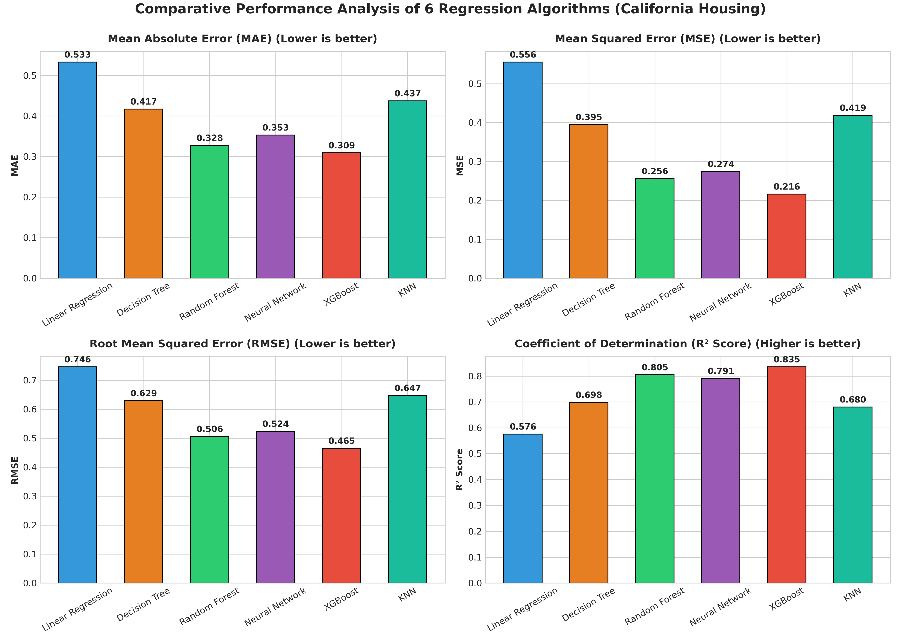
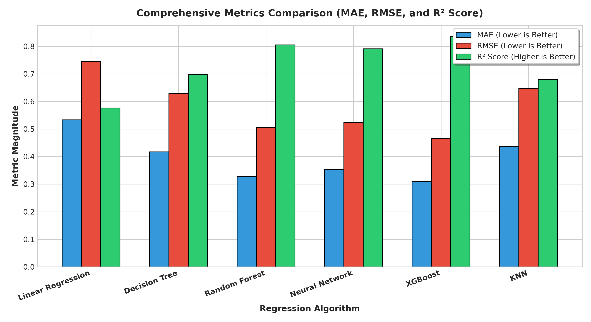
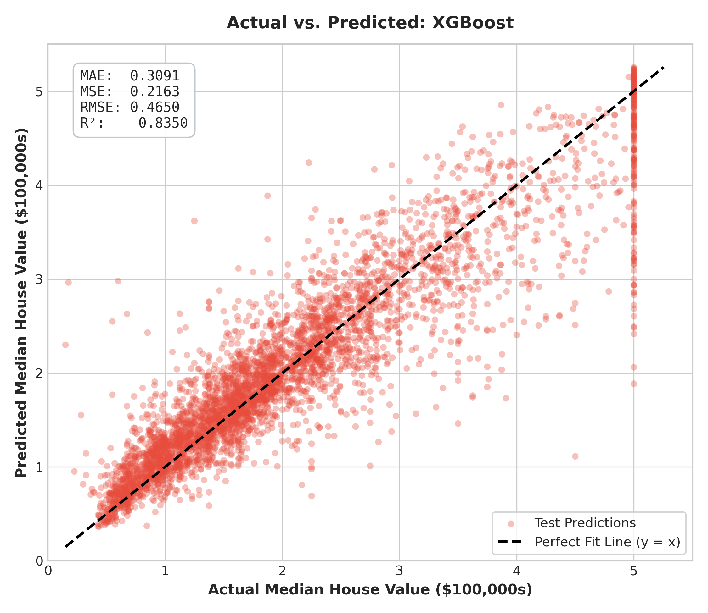
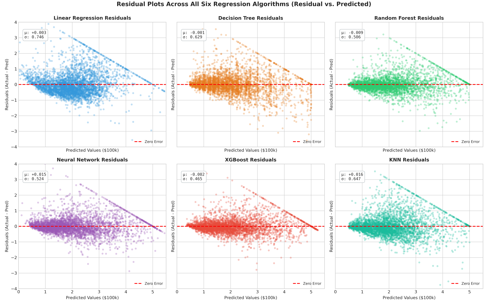
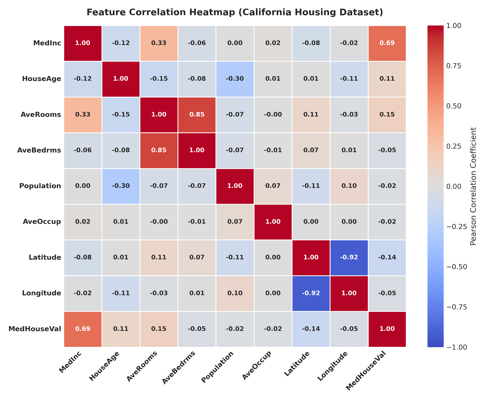

# LAB 10: Comparative Implementation of Machine Learning Regression Algorithms

**Course:** Machine Learning / Computer Vision  
**Author:** Atif Ali Shah  
**Student ID:** FA23-BAI-004  
**Degree:** BS Artificial Intelligence  
**Repository:** [AtifAliShah/ComputerVision-LABS](https://github.com/AtifAliShah/ComputerVision-LABS)  
**Lab Folder:** [Lab10](https://github.com/AtifAliShah/ComputerVision-LABS/tree/main/Lab10)  

---

## 📋 Laboratory Overview
This laboratory conducts an exhaustive, empirical comparative analysis of **six foundational and modern machine learning regression algorithms** applied to an identical real-world regression problem:

1. **Ordinary Least Squares Linear Regression** (`sklearn.linear_model.LinearRegression`)
2. **Decision Tree Regression (CART)** (`sklearn.tree.DecisionTreeRegressor`)
3. **Random Forest Regression (Bagging Ensemble)** (`sklearn.ensemble.RandomForestRegressor`)
4. **Multilayer Perceptron Neural Network Regression** (`sklearn.neural_network.MLPRegressor`)
5. **XGBoost Regression (Gradient Boosting)** (`xgboost.XGBRegressor`)
6. **K-Nearest Neighbors Regression (Distance-Weighted KNN)** (`sklearn.neighbors.KNeighborsRegressor`)

All six algorithms solve the exact same regression task: predicting continuous California district median house values (`MedHouseVal`) from an identical 80:20 training/testing partition (`random_state=42`) with standardized, leakage-free preprocessing pipelines.

---

## 📊 Dataset Information: California Housing
- **Source:** 1990 U.S. Census via `sklearn.datasets.fetch_california_housing`
- **Total Records:** 20,640 samples
- **Features:** 8 continuous predictors:
  - `MedInc`: Median income in block group ($10,000s)
  - `HouseAge`: Median house age in block group (years)
  - `AveRooms`: Average number of rooms per household
  - `AveBedrms`: Average number of bedrooms per household
  - `Population`: Block group population count
  - `AveOccup`: Average number of household members
  - `Latitude`: Block group latitude coordinate
  - `Longitude`: Block group longitude coordinate
- **Target Variable:** `MedHouseVal` (Median house value for California districts, expressed in hundreds of thousands of dollars, i.e., $100,000s)
- **Data Quality:** 0 missing values, 0 duplicate records.

---

## 🛠️ Technologies & Libraries Used
- **Language:** Python 3.10+ / 3.13
- **Data Manipulation:** `pandas`, `numpy`
- **Machine Learning & Preprocessing:** `scikit-learn`
- **Gradient Boosting:** `xgboost`
- **Data Visualization:** `matplotlib`, `seaborn`
- **Interactive Computation:** `jupyter`, `nbformat`, `nbconvert`

---

## 📁 Repository Structure
```text
Lab10/
│
├── Lab10_Regression_Comparison.ipynb    # Fully executed, reproducible Jupyter Notebook
├── README.md                            # Complete lab overview & execution instructions
├── Lab10_Report.md                      # Comprehensive academic laboratory research report
├── requirements.txt                     # Pinned project dependencies
│
├── results/
│   ├── figures/
│   │   ├── target_distribution.png                     # Target variable histogram & KDE
│   │   ├── correlation_heatmap.png                     # Pearson correlation matrix heatmap
│   │   ├── actual_vs_predicted_linear_regression.png   # OLS scatter & diagonal fit
│   │   ├── actual_vs_predicted_decision_tree.png       # Decision Tree scatter & diagonal fit
│   │   ├── actual_vs_predicted_random_forest.png       # Random Forest scatter & diagonal fit
│   │   ├── actual_vs_predicted_neural_network.png      # MLP Neural Network scatter & diagonal fit
│   │   ├── actual_vs_predicted_xgboost.png             # XGBoost scatter & diagonal fit
│   │   ├── actual_vs_predicted_knn.png                 # KNN scatter & diagonal fit
│   │   ├── model_comparison.png                        # 4-panel bar comparison (MAE, MSE, RMSE, R²)
│   │   ├── residual_comparison.png                     # 6-panel residual analysis vs. predicted
│   │   └── metrics_comparison.png                      # Multi-metric grouped benchmark chart
│   │
│   └── tables/
│       ├── model_performance.csv                       # Machine-readable performance metrics
│       └── model_performance.md                        # Markdown-formatted performance table
```

---

## ⚡ Installation & Setup

1. **Clone the repository:**
   ```bash
   git clone https://github.com/AtifAliShah/ComputerVision-LABS.git
   cd ComputerVision-LABS/Lab10
   ```

2. **Create and activate a virtual environment (recommended):**
   ```bash
   python -m venv venv
   # On Windows:
   venv\Scripts\activate
   # On macOS/Linux:
   source venv/bin/activate
   ```

3. **Install dependencies:**
   ```bash
   pip install -r requirements.txt
   ```

---

## 🚀 Execution Instructions

### Running the Complete Experiment Script
To retrain all six models, compute test metrics, and regenerate all figures and tables:
```bash
python run_experiments.py
```

### Running the Interactive Jupyter Notebook
To launch and inspect the complete, step-by-step interactive notebook:
```bash
jupyter notebook Lab10_Regression_Comparison.ipynb
```

---

## 📈 Experimental Performance Comparison

All models were evaluated on the exact same 20% hold-out test set (4,128 samples). Below are the **actual, unassumed experimental metrics**:

| Algorithm | MAE ($100k) | MSE | RMSE ($100k) | R² Score | Training Time (s) | Model Rank |
|:---|:---:|:---:|:---:|:---:|:---:|:---:|
| **XGBoost Regression** | **0.3091** | **0.2163** | **0.4650** | **0.8350** | 0.77s | 🥇 **1st (Best)** |
| **Random Forest Regression** | 0.3277 | 0.2558 | 0.5057 | 0.8048 | 7.34s | 🥈 2nd |
| **Neural Network (MLP)** | 0.3533 | 0.2745 | 0.5239 | 0.7905 | 9.88s | 🥉 3rd |
| **Decision Tree Regression** | 0.4171 | 0.3953 | 0.6287 | 0.6983 | 0.25s | 4th |
| **K-Nearest Neighbors (KNN)** | 0.4375 | 0.4191 | 0.6474 | 0.6801 | 0.07s | 5th |
| **Linear Regression (OLS)** | 0.5332 | 0.5559 | 0.7456 | 0.5758 | 0.07s | 6th |

> **Evaluation Metrics Formulas:**
> - $\text{MAE} = \frac{1}{n}\sum_{i=1}^{n} |y_i - \hat{y}_i|$
> - $\text{MSE} = \frac{1}{n}\sum_{i=1}^{n} (y_i - \hat{y}_i)^2$
> - $\text{RMSE} = \sqrt{\text{MSE}}$
> - $R^2 = 1 - \frac{\sum (y_i - \hat{y}_i)^2}{\sum (y_i - \bar{y})^2}$

---

## 🖼️ Key Visualizations

### 1. Overall Model Comparison (MAE, MSE, RMSE, R²)


### 2. Comprehensive Metrics Comparison


### 3. Actual vs. Predicted (Best Model: XGBoost)


### 4. Residual Comparison Across All Six Algorithms


### 5. Feature Correlation Heatmap


---

## 🔍 Key Findings & Theoretical Insights

1. **XGBoost is the Clear Winner ($R^2 = 0.8350$, $\text{RMSE} = 0.4650$):**
   - Extreme Gradient Boosting sequentially optimizes shallow trees using second-order Taylor approximations (gradient and hessian).
   - It captures complex geospatial non-linearities (`Latitude` and `Longitude` spatial coordinates) and interactions with `MedInc` far better than linear or distance-based models.
   - Built-in regularization ($\gamma, \lambda$) prevents overfitting and ensures generalizability.

2. **Ensemble Methods Dramatically Outperform Single Estimators:**
   - Single Decision Tree achieved $R^2 = 0.6983$, whereas Random Forest improved this to $R^2 = 0.8048$ (a +10.65% boost in explained variance) by bagging 100 decorrelated trees.
   - XGBoost further reduced the error variance down to $\text{MSE} = 0.2163$.

3. **Neural Networks Excel on Continuous Multi-Feature Data ($R^2 = 0.7905$):**
   - The two-layer MLP `(64, 32)` with ReLU activations discovered continuous non-linear representations, competitive with tree ensembles, but required 10× more computational training time.

4. **Failure of the Linearity Assumption ($R^2 = 0.5758$):**
   - Ordinary Least Squares Linear Regression had the highest error ($\text{RMSE} = 0.7456$, explaining only 57.6% of the variance). Housing prices exhibit severe geographical clustering and non-linear thresholds that a hyper-plane cannot model.

---

## 📜 Academic Report
For an exhaustive, publication-style laboratory analysis including mathematical derivations, hyperparameter justifications, failure-case diagnostics, and academic literature citations, refer to [Lab10_Report.md](Lab10_Report.md).

---

**© 2026 Atif Ali Shah (FA23-BAI-004)**. All rights reserved.
