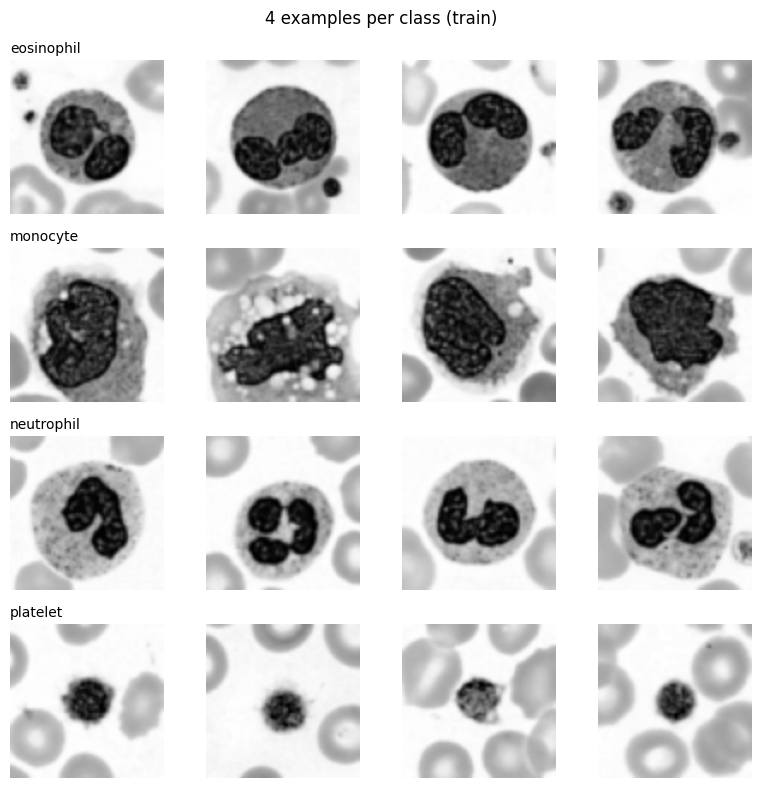
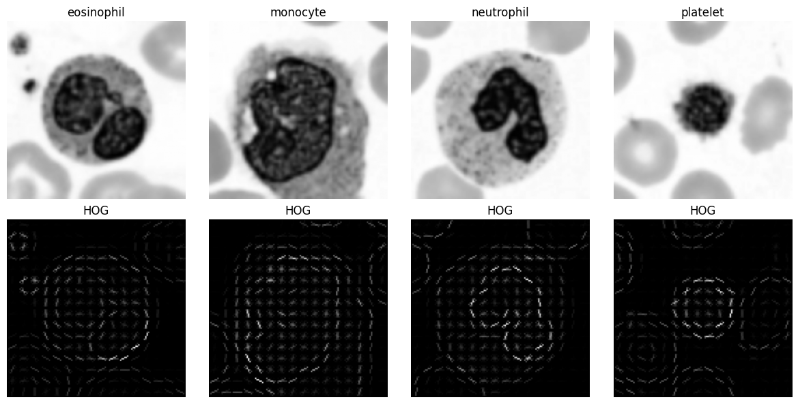
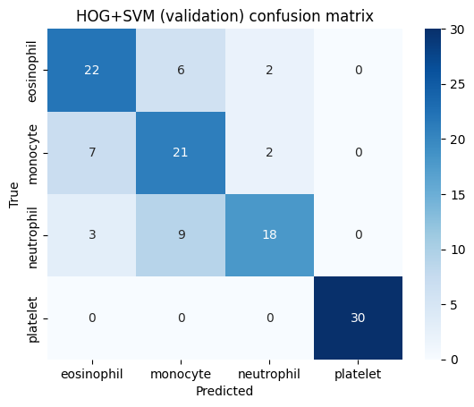
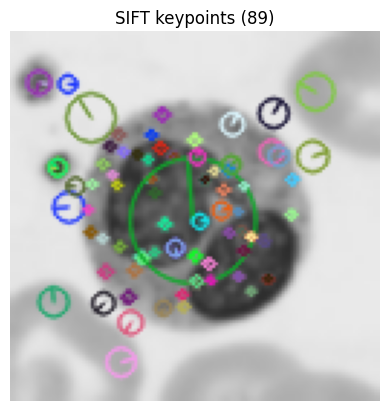
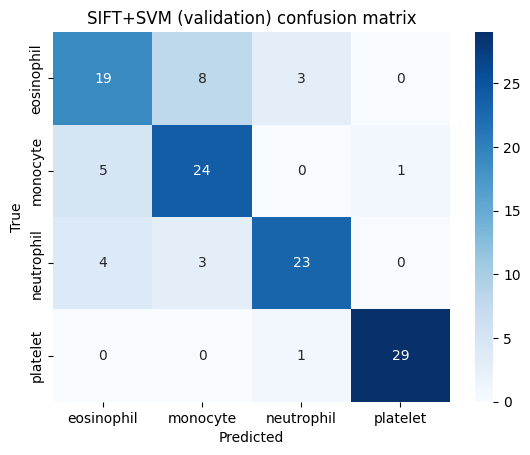
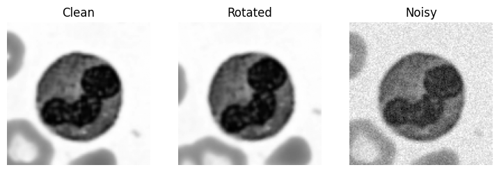

<h1 align="center">🩸 HOG vs SIFT on Blood-Cell Images</h1>

  <b>Computer Vision Lab Mid Exam</b> 
  Roll No: <b>FA23-BAI-004</b>

  
  
  
  
  

---

## 🎯 Goal
Build two classical pipelines, **HOG + SVM** and **SIFT + SVM**, to classify blood cells and find which one is more reliable when images are **rotated** or **noisy**.

## ⚙️ Personal Settings
| Setting | Value | Reason |
|---|---|---|
| Seed | **4** | last two digits "04" |
| HOG cell size | **8 x 8** | last digit 4 is even |
| SIFT grid | **4 x 4 (16 keypoints)** | last digit 4 is in 0 to 4 |

## 🗂️ Dataset
BloodMNIST (size 64), 4 classes: **eosinophil, monocyte, neutrophil, platelet**.
Per class: 100 train / 30 validation / 30 test. Grayscale, resized to 128 x 128.
Shapes: Train `(400,128,128)`, Val `(120,128,128)`, Test `(120,128,128)`.

 <i>4 example images per class</i>

---

## 🔹 HOG + SVM
**Feature length:** 16 x 16 cells, 15 x 15 blocks, 36 values per block: 225 x 36 = **8100**

 <i>HOG picture for one image of each class</i>

| Best C | Val Accuracy | Macro-F1 |
|---|---|---|
| 0.1 | **0.7583** | **0.7596** |

 <i>HOG + SVM confusion matrix (validation)</i>

---

## 🔹 SIFT + SVM
**Normal SIFT:** average 70.92 keypoints per image, min 10, max 160, 0 images with zero keypoints.
Different counts per image give different vector lengths, which an SVM cannot accept.

 <i>SIFT keypoints drawn on one image</i>

**Fix:** a fixed 4 x 4 grid (keypoint size 32), so features = 16 x 128 = **2048**.

| Best C | Val Accuracy | Macro-F1 |
|---|---|---|
| 0.1 | **0.7917** | **0.7918** |

 <i>SIFT + SVM confusion matrix (validation)</i>

---

## 🧪 Robustness Test (Test Set)
Rotation = 20 degrees, noise = Gaussian sigma 0.05, applied before feature extraction.

 <i>Clean, rotated and noisy example</i>

| Model | Clean | Rotated (20°) | Noisy (σ=0.05) |
|---|---|---|---|
| HOG + SVM | 0.7000 | 0.7333 | 0.6000 |
| SIFT + SVM | 0.7833 | 0.7833 | 0.7750 |

**Prediction check:**
- Noise prediction ✅ correct: HOG dropped 0.1000, SIFT only 0.0083.
- Rotation prediction ❌ wrong: HOG did not lose accuracy (0.70 → 0.7333) and SIFT stayed at 0.7833.

## 🔍 Most Confused Classes
- HOG + SVM: neutrophil predicted as monocyte (9 times)
- SIFT + SVM: eosinophil predicted as monocyte (8 times)

Grayscale removes the stain colour, which is the main clue between white blood cell types, so these classes are harder to separate. Platelet is almost perfect.

## 🏁 Conclusion
SIFT with a fixed grid was better on validation (0.7917 vs 0.7583) and much more robust to noise. HOG was badly affected by noise.

## 📁 Files
| File | Description |
|---|---|
| `FA23-BAI-004_LabMid_Final.ipynb` | Executed notebook with all outputs and answers (Q1 to Q5) |
| `images/` | Plots used in this README |
| `README.md` | This file |

## ▶️ How to Run
Open the notebook in Google Colab and click **Runtime → Run all** (`pip install medmnist` is included).
